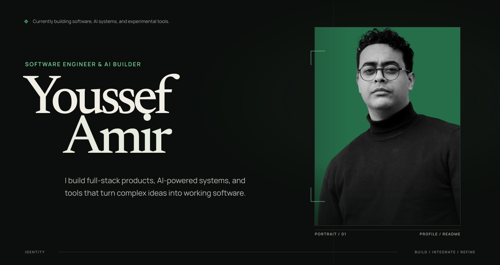

<!-- Youssef Amir — GitHub profile README -->
<!-- Place this README.md in a PUBLIC repository named exactly Virtuoso-afk -->

<div align="center">



<br />

### Building useful things for the internet.

**Software Developer** &nbsp;·&nbsp; **AI / ML Enthusiast** &nbsp;·&nbsp; **Product Builder**

Based in Cairo, Egypt &nbsp;·&nbsp; Curious about everything between an idea and a shipped product.

<br />

<a href="https://me.yousseflabs.xyz"></a>
<a href="https://yousseflabs.xyz"></a>
<a href="https://riftsense.online"></a>

</div>

<br />

## 01 / About

I'm **Youssef Amir**, a developer focused on turning ambitious ideas into practical software. My interests sit at the intersection of **software engineering, AI, and product design**.

I enjoy working across the stack: understanding a problem, designing the experience, building the system, testing it, and getting it into people's hands. I'm particularly interested in **AI-enabled applications, developer tools, automation, and thoughtful user experiences**.

I believe the best way to learn engineering is to **build, test, ship, and iterate**.

```text
CURRENT FOCUS
  → Building useful, production-minded web applications
  → Learning and applying machine learning / AI
  → Improving software architecture, reliability, and developer experience
```

## 02 / Selected work

<table>
  <tr>
    <td width="50%" valign="top">
      <h3>⚡ YoussefLabs</h3>
      <p><strong>Everyday tools. Thoughtful engineering.</strong></p>
      <p>A growing collection of browser-based utilities for JSON, images, PDFs, and everyday developer workflows, built to feel simple and fast.</p>
      <p><code>Next.js</code> <code>TypeScript</code> <code>React</code> <code>Tailwind CSS</code></p>
      <p><a href="https://yousseflabs.xyz"><strong>Explore live product ↗</strong></a></p>
    </td>
    <td width="50%" valign="top">
      <h3>🎯 RiftSense</h3>
      <p><strong>Turn matches into meaningful improvement.</strong></p>
      <p>A League of Legends coaching experience that translates match data into actionable performance insights and next-game goals.</p>
      <p><code>Next.js</code> <code>TypeScript</code> <code>Product Analytics</code></p>
      <p><a href="https://riftsense.online"><strong>Explore live product ↗</strong></a></p>
    </td>
  </tr>
</table>

<p align="center"><a href="https://me.yousseflabs.xyz"><strong>See more projects and the stories behind them →</strong></a></p>

## 03 / Engineering toolbox

**Languages & foundations**

    

**Web & application development**

   

**AI, data & experimentation**

   

**Tools & workflow**

   

## 04 / Beyond the code

- **Product thinking:** solving actual problems, not just collecting technologies.
- **Engineering discipline:** automated tests, accessibility, performance, and maintainability.
- **Continuous learning:** CS50, networking fundamentals, and hands-on AI/ML exploration.
- **Creative experiments:** interfaces, music tools, and interactive experiences.

## 05 / GitHub activity

<div align="center">
  <picture>
    <source srcset="https://github-readme-stats.vercel.app/api?username=Virtuoso-afk&amp;show_icons=true&amp;hide_border=true&amp;theme=github_dark&amp;bg_color=0d1117" media="(prefers-color-scheme: dark)" />
    
  </picture>
</div>

<sub>Stats are provided by a third-party service and may sometimes be unavailable.</sub>

---

<div align="center">

### Have an idea worth building?

I'm always interested in thoughtful software, useful AI, and people who love turning ideas into real products.

**[Explore my portfolio](https://me.yousseflabs.xyz)** &nbsp;·&nbsp; **[Browse my repositories](https://github.com/Virtuoso-afk?tab=repositories)**

<sub>Designed and built by Youssef Amir · Cairo, Egypt</sub>

</div>
