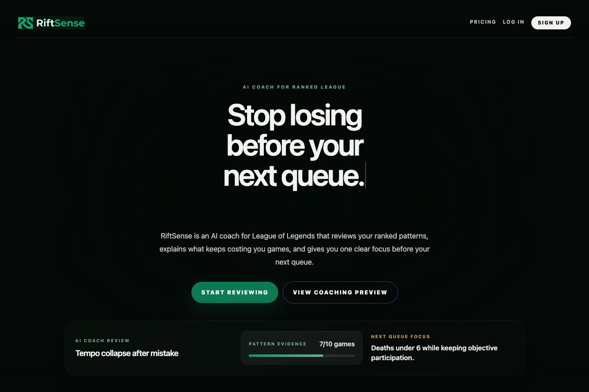
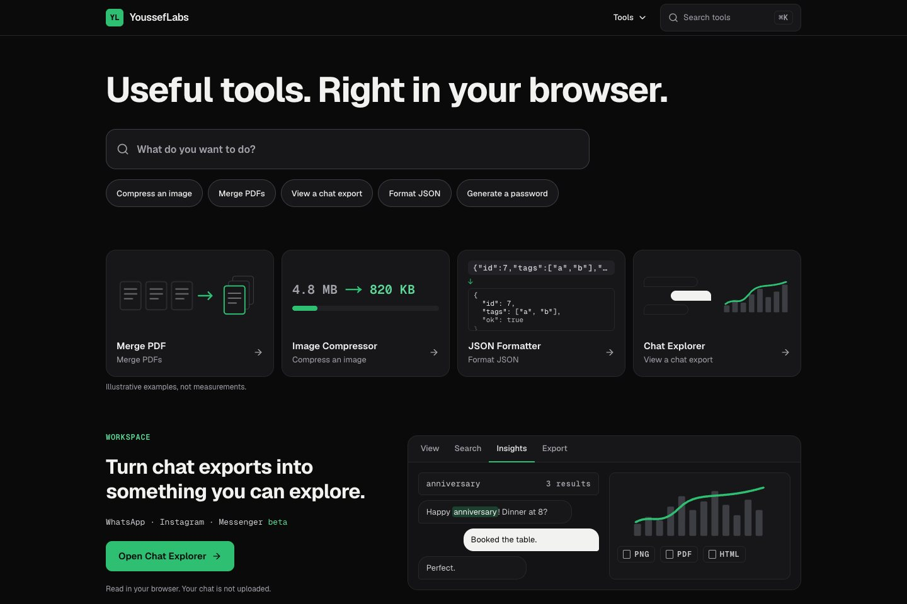
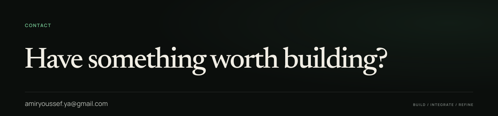

<h1 align="center">
  
</h1>

  <strong>Software Engineer &amp; AI Builder</strong> 
  Currently building software, AI systems, and experimental tools.

  <a href="https://me.yousseflabs.xyz"><strong>Portfolio</strong></a> &nbsp;·&nbsp;
  <a href="https://riftsense.online">RiftSense</a> &nbsp;·&nbsp;
  <a href="https://yousseflabs.xyz">YoussefLabs</a> &nbsp;·&nbsp;
  <a href="https://www.linkedin.com/in/youssef-amir-5a17b3281/">LinkedIn</a> &nbsp;·&nbsp;
  <a href="mailto:amiryoussef.ya@gmail.com">Email</a>

## 01 — Selected work

### RiftSense

**AI-powered gaming / coaching product · Active development**

An AI-assisted League of Legends coaching product that turns match data into actionable, personalized guidance.

| | |
|---|---|
| **Contribution** | Product engineering · Full-stack development · AI systems |
| **Product focus** | Match information is only useful when it helps a player decide what to focus on now, what is improving, and what to review next. |
| **Technology** | Next.js · TypeScript · Tailwind CSS · Riot API · AI systems |

**[Visit RiftSense ↗](https://riftsense.online)**

### YoussefLabs

**Free, fast, local-first browser utilities**

A utility hub for developers, creators, and everyday tasks: merge PDFs, compress images, format JSON, and explore chat exports. Processing happens client-side, with no server uploads.

| | |
|---|---|
| **Product focus** | Useful tools, right in your browser. |
| **Technology** | Next.js |

**[Visit YoussefLabs ↗](https://yousseflabs.xyz)**

## 02 — Engineering practice

I build web products from the interface to the services behind them, and bring in AI where the product needs it.

| Area | What it means | Tools |
|---|---|---|
| **Product engineering** | Building polished web products from the interface through the application structure. | TypeScript · React · Next.js · Responsive UI · Accessibility |
| **AI systems** | Building AI-assisted product behavior, pairing LLM integration with deterministic, rule-based logic. | LLM integration · Rule-based logic · Python |
| **Backend &amp; integration** | Working across APIs, application services, and data-connected systems. | C# · .NET · APIs · SQL |
| **Developer workflow** | Using modern tooling and automation to iterate, validate, and ship software. | Git · Docker · Linux · AI coding agents |

## 03 — Experience

**El Reef El Masry / ECDC** — Coordination, Follow-up &amp; Development Specialist *(current role)*

Frontend development and digital product work within an existing enterprise web environment.

- Frontend and public-facing web implementation
- Translating product and business requirements into interfaces
- Improving responsive, accessible web experiences within existing technical constraints
- Supporting digital development and automation initiatives

## 04 — About

I came into software from a business and accounting background, then moved deeper into computer science, product engineering, and AI by building.

I learn best by turning ideas into working systems, testing them, and refining them against real constraints. My curiosity runs across software, AI, and systems.

**Formal education** — Bachelor's degree in Business Administration (Accounting &amp; Management), International Academy of Engineering and Media Sciences (IAEMS).

**Selected coursework** — Harvard CS50x, Introduction to Computer Science · Harvard CS50P, Introduction to Programming with Python.

## 05 — Contact

**[amiryoussef.ya@gmail.com](mailto:amiryoussef.ya@gmail.com)** &nbsp;·&nbsp; [LinkedIn ↗](https://www.linkedin.com/in/youssef-amir-5a17b3281/) &nbsp;·&nbsp; [Portfolio ↗](https://me.yousseflabs.xyz)
